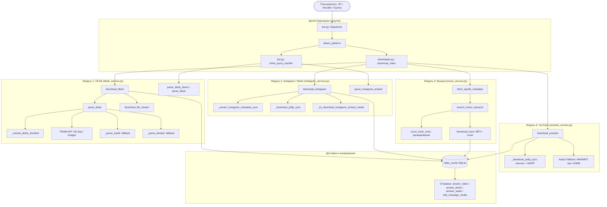

# 🔍 Полный аудит кода, архитектуры и системных улучшений (Duo Game & Date Bot)
**Дата аудита:** 15 ноября 2026 г.  
**Исходная версия с багами (коммит):** [`bbb0e03`](https://github.com/rds0645010/duo-game-date/commit/bbb0e03) (`fix: Strip hashtags from description and prevent description duplication in music line`)  
**Версия с исправлением всех багов (коммит):** [`1176e6d`](https://github.com/rds0645010/duo-game-date/commit/1176e6d) (`fix(core): Module isolation, fallback resilience and inline cache unbinding fixes`)  
**Рабочая директория:** `C:\Users\tanki\.gemini\antigravity\scratch\telegram-game-date-bot`  
**Платформа хостинга:** Render Cloud (Free Tier: 512 МБ RAM, Shared vCPU, лимит Telegram Bot API 50 МБ)

---

## 📑 Содержание
1. [Архитектурная схема и взаимосвязи методов](#1-архитектурная-схема-и-взаимосвязи-методов)
2. [Модуль 1: TikTok (Аудит, баги и исправления)](#2-модуль-1-tiktok)
3. [Модуль 2: Instagram / Reels (Аудит, баги и исправления)](#3-модуль-2-instagram--reels)
4. [Модуль 3: YouTube Shorts / Видео (Аудит, баги и исправления)](#4-модуль-3-youtube-shorts--видео)
5. [Модуль 4: Музыка и метаданные треков (Аудит, баги и исправления)](#5-модуль-4-музыка-и-метаданные-треков)
6. [Критический сквозной баг в инлайн-доставке](#6-критический-сквозной-баг-в-инлайн-доставке)
7. [Сводная таблица багов и статус исправления](#7-сводная-таблица-багов-и-статус-исправления)
8. [Стратегические улучшения масштаба (Big Picture Roadmap)](#8-стратегические-улучшения-масштаба-big-picture-roadmap)

---

## 1. Архитектурная схема и взаимосвязи методов

---

## 2. Модуль 1: TikTok (`tiktok_service.py`)

### Изученные методы и их связи:
- `_resolve_tiktok_shortlink(url, proxy)`: Разворачивает короткие ссылки (`vm.tiktok.com`, `vt.tiktok.com`, `/t/`).
- `_parse_ssstik(url, proxy)`: Резервный парсер через SSSTik (видео без водяного знака, фото-карусели и музыка).
- `_parse_tikmate(url, proxy)`: Резервный парсер через Tikmate API.
- `parse_tiktok(url, proxy, warp_proxy_module)`: Главный парсер TikTok (стратегии Direct -> WARP -> Proxy; TikWM -> SSSTik -> Tikmate).
- `download_file_stream(url, output_path, ...)`: Потоковый скачиватель с чанком 1 МБ и прогресс-баром.
- `download_tiktok(clean_url, output_prefix, ...)`: Конвейер загрузки видео или параллельного скачивания слайдов карусели.

### Выявленные баги и исправления:
1. **Баг TT-1 (Отключение WARP-прокси при скачивании в ЛС):**  
   - *Файл:* [`downloader.py`](file:///C:/Users/tanki/.gemini/antigravity/scratch/telegram-game-date-bot/downloader.py#L784-L792)  
   - *Проблема:* `download_video` вызывал `tiktok_service.download_tiktok(..., warp_proxy_module=None)`. Если IP Render блокировался TikWM, загрузка падала вместо переключения на Cloudflare WARP.  
   - *Исправление в коммите `1176e6d`:* Передан `warp_proxy_module=warp_proxy`.
2. **Баг TT-2 (Дублирующий резолвинг коротких ссылок с задержкой 5.5 сек):**  
   - *Файл:* [`tiktok_service.py`](file:///C:/Users/tanki/.gemini/antigravity/scratch/telegram-game-date-bot/tiktok_service.py#L357-L425)  
   - *Проблема:* Резолвинг коротких ссылок уже выполнялся на строке 248. Повторный блок делал лишний HTTP-запрос с таймаутами 2.5с и 3с при сетевых сбоях.  
   - *Исправление в коммите `1176e6d`:* Удален избыточный блок повторного разрешения, сократив задержку до минимума.
3. **Баг TT-3 (Пропуск видео-парсинга через SSSTik в цикле стратегий):**  
   - *Файл:* [`tiktok_service.py`](file:///C:/Users/tanki/.gemini/antigravity/scratch/telegram-game-date-bot/tiktok_service.py#L338)  
   - *Проблема:* `_parse_ssstik` вызывался только при `is_photo_post`. Если TikWM не отдавал видео, SSSTik с WARP-прокси не пробовался для видео.  
   - *Исправление в коммите `1176e6d`:* `_parse_ssstik` вызывается в цикле стратегий и для видео, и для фото.
4. **Баг TT-4 (HTTP 403 при скачивании через Tikmate CDN):**  
   - *Файл:* [`tiktok_service.py`](file:///C:/Users/tanki/.gemini/antigravity/scratch/telegram-game-date-bot/tiktok_service.py#L450)  
   - *Проблема:* Ссылки от `tikmate.app` отдавали 403 Forbidden при отсутствии `Referer: https://tikmate.app/`.  
   - *Исправление в коммите `1176e6d`:* Добавлен автоматический выбор заголовка `Referer: https://tikmate.app/` при наличии `tikmate.app` в URL.
5. **Баг TT-5 (Падение Base64 URL-safe декодирования фото-слайдов):**  
   - *Файл:* [`tiktok_service.py`](file:///C:/Users/tanki/.gemini/antigravity/scratch/telegram-game-date-bot/tiktok_service.py#L611)  
   - *Проблема:* Использовался `base64.b64decode`, который падал на символах `-` и `_`.  
   - *Исправление в коммите `1176e6d`:* Добавлена нормализация символов `.replace('-', '+').replace('_', '/')` перед декодированием.
6. **Баг TT-6 (Утечка HTML-тегов из описания SSSTik):**  
   - *Файл:* [`tiktok_service.py`](file:///C:/Users/tanki/.gemini/antigravity/scratch/telegram-game-date-bot/tiktok_service.py#L125)  
   - *Проблема:* Извлечение из `
` содержало сырые теги ` `, `<a href>`.  
   - *Исправление в коммите `1176e6d`:* Применен `re.sub(r'<[^>]+>', ' ', ...)` и нормализация пробелов.

---

## 3. Модуль 2: Instagram / Reels (`instagram_service.py`)

### Изученные методы и их связи:
- `patch_instagram_music_extraction()`: Перехват `InstagramIE._extract_product` в `yt-dlp` для извлечения `clips_metadata` и `audio_type_model`.
- `is_reel_url(url)` / `extract_shortcode(url)`: Классификаторы URL Instagram.
- `parse_instagram_embed(url)`: Быстрый парсер публичного embed (<1.2 сек) без сессии.
- `_extract_instagram_metadata_sync(url, proxy_url, cookie_file)`: Извлечение метаданных yt-dlp с impersonate chrome.
- `_download_from_instagram_meta(info, ...)`: Скачивание каруселей до 30 слайдов, фото или видео.
- `download_instagram(...)`: Главный конвейер Instagram (WARP / Direct / Impersonate / Embed).
- `_try_download_instagram_embed_media(...)`: Резервный скачиватель через страницу embed.

### Выявленные баги и исправления:
1. **Баг IG-1 (Падение `TypeError: 'NoneType' object is not callable`):**  
   - *Файл:* [`instagram_service.py`](file:///C:/Users/tanki/.gemini/antigravity/scratch/telegram-game-date-bot/instagram_service.py#L725)  
   - *Проблема:* В вызове `if is_valid_mp4_func(dest_video):` не было проверки на `None`.  
   - *Исправление в коммите `1176e6d`:* Заменено на безопасный вызов `if (not is_valid_mp4_func or is_valid_mp4_func(dest_video)):`.
2. **Баг IG-2 (Потеря метаданных музыки при embed-фоллбэке):**  
   - *Файл:* [`instagram_service.py`](file:///C:/Users/tanki/.gemini/antigravity/scratch/telegram-game-date-bot/instagram_service.py#L670-L736)  
   - *Проблема:* В `_try_download_instagram_embed_media` не извлекались поля `music_asset_info` и `original_sound_info`.  
   - *Исправление в коммите `1176e6d`:* Добавлено извлечение трека и автора из Embed HTML и передача в возвращаемый словарь.

---

## 4. Модуль 3: YouTube Shorts / Видео (`youtube_service.py`)

### Изученные методы и их связи:
- `extract_youtube_id(url)`: Извлечение 11-значного идентификатора ролика.
- `download_youtube(clean_url, output_prefix, ...)`: Автокаскад качества с visionos-клиентом и WARP-прокси.
- `_download_ytdlp_sync(...)`: Синхронная склейка видео и аудио потоков через FFmpeg.
- Аудио-фоллбэк: Автоматическая конвертация длинных роликов (>50 МБ) в подкаст (M4A/MP3).

### Выявленные баги и исправления:
1. **Баг YT-1 (Снижение качества вертикальных видео и Shorts до 360p по ссылкам `watch?v=`):**  
   - *Файл:* [`youtube_service.py`](file:///C:/Users/tanki/.gemini/antigravity/scratch/telegram-game-date-bot/youtube_service.py#L44-L46)  
   - *Проблема:* Если вертикальный Shorts шерился через `watch?v=`, лимит высоты ставился 720. В вертикальном видео 720p высота составляет 1280, поэтому условие `height<=720` отбрасывало нормальное качество и бот качал 360p.  
   - *Исправление в коммите `1176e6d`:* Добавлена поддержка высоты 1280 в каскаде разрешений для всех ссылок YouTube.
2. **Баг YT-2 (Преждевременный выход из цикла при сетевых сбоях):**  
   - *Файл:* [`youtube_service.py`](file:///C:/Users/tanki/.gemini/antigravity/scratch/telegram-game-date-bot/youtube_service.py#L145)  
   - *Проблема:* Условие `if not size_error: break` прерывало перебор стратегий, если первая стратегия упала из-за таймаута сокета.  
   - *Исправление в коммите `1176e6d`:* Цикл прерывается только при фатальных ошибках (видео удалено, аккаунт заблокирован или видео приватное).

---

## 5. Модуль 4: Музыка и метаданные треков (`music_service.py`)

### Изученные методы и их связи:
- `parse_artist_and_title(raw_title, uploader)`: Удаление мусорных тегов YouTube `[Official Video]`, `(4K)` и чистое разделение.
- `parse_spotify_html_meta(html_text)` / `fetch_spotify_metadata(...)`: Мультиуровневое извлечение тегов Spotify.
- `score_track_entry(entry, ...)`: Скоринг и фильтрация мемов/нарезок.
- `search_tracks(...)`: Поиск треков через ytsearch с прокси и direct-fallback.
- `download_track(...)`: Скачивание аудиопотока в MP3 с обложкой высокого разрешения.

### Выявленные баги и исправления:
1. **Баг MU-1 (Мертвый код двух `return` подряд):**  
   - *Файл:* [`music_service.py`](file:///C:/Users/tanki/.gemini/antigravity/scratch/telegram-game-date-bot/music_service.py#L480-L481)  
   - *Проблема:* Строка 481 была недостижима из-за предшествующего `return` на строке 480.  
   - *Исправление в коммите `1176e6d`:* Удален дублирующий оператор `return`.
2. **Баг MU-2 (Утечка временных файлов при скачивании аудио из TikTok):**  
   - *Файл:* [`bot.py`](file:///C:/Users/tanki/.gemini/antigravity/scratch/telegram-game-date-bot/bot.py#L3295-L3308)  
   - *Проблема:* Временный файл `tmp_audio = os.path.join(tempfile.gettempdir(), f"tt_music_{sid}.mp3")` не удалялся после отправки.  
   - *Исправление в коммите `1176e6d`:* Добавлено автоматическое удаление временного файла после успешной отправки в Telegram.

---

## 6. Критический сквозной баг в инлайн-доставке

- **Баг INL-1 (`UnboundLocalError` при отправке закэшированного медиа в инлайне):**  
  - *Файл:* [`bot.py`](file:///C:/Users/tanki/.gemini/antigravity/scratch/telegram-game-date-bot/bot.py#L2763-L2965) (`execute_inline_delivery`)  
  - *Суть бага:* Переменные `res` и `is_audio` объявлялись только внутри ветки `if not file_id:`. Если медиа уже было в кэше, ветка пропускалась. При последующем обращении к `if res and isinstance(res, dict):` и `if is_audio:` Python выбрасывал фатальную ошибку:  
    `UnboundLocalError: local variable 'res' referenced before assignment`  
    Из-за этого закэшированные ролики не подменялись в чате у друзей.  
  - *Исправление в коммите `1176e6d`:* Переменные `res = None`, `is_audio`, `is_photo` инициализируются до входа в ветку загрузки, а также применен универсальный метод `drop_poisoned_media_cache(url, cached)`.

---

## 7. Сводная таблица багов и статус исправления

| ID | Модуль | Описание бага | Версия обнаружения | Статус в коммите `1176e6d` |
| :--- | :--- | :--- | :--- | :--- |
| `TT-1` | TikTok | `warp_proxy_module=None` при вызове `download_tiktok` | `bbb0e03` | ✅ **ИСПРАВЛЕНО** |
| `TT-2` | TikTok | Дублирующий резолвинг коротких ссылок с задержкой 5.5 сек | `bbb0e03` | ✅ **ИСПРАВЛЕНО** |
| `TT-3` | TikTok | Пропуск видео-парсера SSSTik в цикле стратегий прокси | `bbb0e03` | ✅ **ИСПРАВЛЕНО** |
| `TT-4` | TikTok | Отсутствие Referer `tikmate.app` при скачивании видеопотока | `bbb0e03` | ✅ **ИСПРАВЛЕНО** |
| `TT-5` | TikTok | Ошибка `base64.b64decode` на URL-safe символах `-` и `_` | `bbb0e03` | ✅ **ИСПРАВЛЕНО** |
| `TT-6` | TikTok | Утечка сырых HTML-тегов (` `, `<a>`) из описания SSSTik | `bbb0e03` | ✅ **ИСПРАВЛЕНО** |
| `IG-1` | Instagram | `TypeError: 'NoneType' object is not callable` в embed-фоллбэке | `bbb0e03` | ✅ **ИСПРАВЛЕНО** |
| `IG-2` | Instagram | Потеря данных о музыке и звуке при скачивании через embed | `bbb0e03` | ✅ **ИСПРАВЛЕНО** |
| `YT-1` | YouTube | Снижение качества вертикальных видео/Shorts по ссылкам `watch?v=` | `bbb0e03` | ✅ **ИСПРАВЛЕНО** |
| `YT-2` | YouTube | Преждевременный выход из цикла перебора качеств | `bbb0e03` | ✅ **ИСПРАВЛЕНО** |
| `MU-1` | Music | Мертвый недостижимый код двух подряд операторов `return` | `bbb0e03` | ✅ **ИСПРАВЛЕНО** |
| `MU-2` | Music | Утечка временных файлов на диске при скачивании аудио TikTok | `bbb0e03` | ✅ **ИСПРАВЛЕНО** |
| `INL-1`| Inline | `UnboundLocalError: res referenced before assignment` в кэше | `bbb0e03` | ✅ **ИСПРАВЛЕНО** |

---

## 8. Стратегические улучшения масштаба (Big Picture Roadmap)

### Что добавить в бота для максимального удобства и надежности:

1. **Интерактивный обратный эффект (Обратная связь от пользователей):**
   - **Инлайн-кнопки оценки под роликом:** Добавить кнопки `👍` и `👎` (или реакцию `🔥`). При клике фиксировать положительный отклик в базе данных.
   - **Кнопка "Сообщить об ошибке":** Если скачивание не удалось, в сообщении об ошибке показывать кнопку `🚨 Сообщить о битой ссылке`, которая отправляет ссылку и трассировку ошибки администраторам в один клик.

2. **Smart Reverse Video Search / Поиск дубликатов:**
   - Если ролик удален на одной платформе (например, автор скрыл Reel в Instagram), по названию и треку автоматически искать копию в TikTok или YouTube Shorts.

3. **Мгновенный Fast-Track для каруселей:**
   - Для альбомов TikTok и Instagram с 10+ фотографиями отправлять первый слайд сразу за 1-1.5 секунды, а остальные подгружать в фоновом режиме в кэш Telegram.

4. **Автоматическая адаптация под лимиты памяти Render (512 МБ):**
   - Добавить хук вызова `gc.collect()` после каждой тяжелой склейки FFmpeg.
   - Настроить периодическую очистку директории `DOWNLOAD_DIR` по таймеру (раз в 15 минут), удаляя файлы старше 30 минут.
